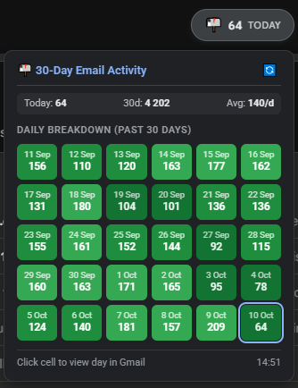

# Gmail Volume Tracker

[](LICENSE)


A lightweight, privacy-focused tool that displays a real-time incoming email volume counter and a 30-day activity heatmap directly in Gmail's top-right header.

Unlike standard inbox counters that only reflect unread messages in your primary view, this tracks **all incoming emails across your entire account**, including:
- **Inbox**
- **Trash**
- **Spam**
- **Archive**
- **All custom labels and categories**

It automatically filters out self-sent emails (`-from:me`) so it strictly measures true incoming email throughput.

## Features

- **Real-Time Daily Volume:** Live count of today's incoming emails docked cleanly next to Gmail's native header icons.
- **30-Day Activity Heatmap:** GitHub-style visual calendar grid displaying daily volume and traffic trends at a single glance without needing to hover.
- **1-Click Historical Search:** Click any day tile on the heatmap to instantly search and view all emails received on that specific date in Gmail.
- **High-Performance Smart Caching:** Historical days are cached in Google Apps Script `PropertiesService` for instantaneous (~1s) responses.

## Screenshots



## Requirements

1. UserScript manager installed in browser:
   - [Tampermonkey](https://www.tampermonkey.net/) (Recommended)
   - [Violentmonkey](https://violentmonkey.github.io/)
   - [Greasemonkey](https://www.greasespot.net/)

## Quick Setup Guide

### 1. Deploy the Backend (Google Apps Script)

1. Open [Google Apps Script](https://script.google.com/) while logged into your Google account.
2. Click **New project** (top left).
3. Name the project `Gmail Volume Tracker`.
4. Delete any existing code in the editor and replace it with the code from [`Code.gs`](Code.gs).
   *(Optional but recommended: configure a `SECURITY_SECRET` on line 11)*
5. Click **Deploy** (blue button in top-right) ➔ **New deployment**.
6. In the modal:
   - Click the gear icon next to "Select type" and choose **Web app**.
   - **Description:** `Gmail Volume Tracker API`
   - **Execute as:** `Me (<your_email>@gmail.com)`
   - **Who has access:** `Anyone` *(Allows your browser userscript to query your private endpoint)*
7. Click **Deploy**.
8. Click **Authorize access**, select your account, click **Advanced**, and then click **Go to Gmail Volume Tracker (unsafe)** to grant Gmail read permissions.
9. Copy the generated **Web App URL** (looks like `https://script.google.com/macros/s/.../exec`).

> [!TIP]
> Google shows the "unsafe" warning because this is your own private script that hasn't been submitted to Google's public OAuth verification. It is running solely in your own account.

### 2. Connect Userscript to Your Web App

1. Click **[Install here](https://raw.githubusercontent.com/NightMean/Gmail-Volume-Tracker/main/gmail-volume-tracker.user.js)**
2. Confirm the installation in your Userscript manager.
3. Open or refresh [Gmail](https://mail.google.com/).
4. Look at the top-right corner next to the Support (`?`) button.
5. Click the badge showing **`setup`** (or open the Tampermonkey menu and click **⚙️ Set Google Apps Script URL**).
6. Paste your Web App URL (with `?token=...` if you configured one) and confirm.
7. The badge will immediately display today's incoming email count!

## Configuration

### Userscript Settings
In [`gmail-volume-tracker.user.js`](gmail-volume-tracker.user.js):

- **Display Mode**: Switch between counting threads or individual messages:
  ```javascript
  const DISPLAY_MODE = 'threads'; // 'threads' | 'messages'
  ```
- **Auto-Refresh Interval**: How often the userscript polls for updates:
  ```javascript
  const REFRESH_INTERVAL_MIN = 5; // Default: 5 minutes
  ```

### Security Token (Recommended)
In [`Code.gs`](Code.gs):
- **Set a custom token**:
  ```javascript
  const SECURITY_SECRET = "my_custom_secret_key";
  ```
- **Configure in Tampermonkey**: Append `?token=my_custom_secret_key` to your Web App URL:
  ```text
  https://script.google.com/macros/s/.../exec?token=my_custom_secret_key
  ```

> [!IMPORTANT]
> **Why is configuring a Security Token recommended?**
>
> The backend script **never exposes email contents, sender details, or subject lines**—it strictly calculates and outputs aggregate count numbers. However, if your Web App URL is discovered or leaked without a token:
> - **Volume Profiling:** Anyone with the URL can query your endpoint to view your daily email volume and 30-day activity history, revealing your traffic and communication habits.
> - **Quota Consumption:** Third-party queries consume your personal daily Google Apps Script execution quota.
>
> Setting `SECURITY_SECRET` ensures the script rejects any unauthorized request missing the token with an immediate `401 Unauthorized` response.

## The Hybrid Architecture

```
┌─────────────────────────────────┐         ┌───────────────────────────────┐
│     Google Apps Script (GAS)    │         │      Tampermonkey Script      │
│          (Google Cloud)         │         │        (Your Browser)         │
│                                 │         │                               │
│ • Runs inside your Google Acct  │  JSON   │ • Matches mail.google.com     │
│ • Has native GmailApp access    │ ◄─────► │ • Injects top-right UI badge  │
│ • Queries "in:anywhere after:X" │         │ • Renders 30-day heatmap grid │
│ • Caches 30-day history in props│         │ • 1-click date search filter  │
└─────────────────────────────────┘         └───────────────────────────────┘
```

- **Backend ([`Code.gs`](Code.gs)):** A lightweight Google Apps Script Web App deployed in your own Google account. It uses `GmailApp.getMessagesForThreads()` and `PropertiesService` to accurately count emails across your entire mailbox in milliseconds.
- **Frontend ([`gmail-volume-tracker.user.js`](gmail-volume-tracker.user.js)):** A userscript that runs on `mail.google.com`, fetches data in the background, and renders a native-styled pill badge and interactive 30-day heatmap panel.

## Donations

If you find this project helpful, you can support its development:

<a href="https://www.buymeacoffee.com/nightmean" target="_blank"></a>

## License

This project is licensed under the [MIT License](LICENSE).
